# Formula dependency map (Part 10, 2026-11-24)

How data flows from what is logged, through every formula, rule and decision, to the screens — drawn from the ACTUAL code,
not from intent. Analysis and visualisation only: no formula, weight, threshold or behaviour was changed for this map.

- **Generated, then curated.** `scripts/formula-graph.mjs` reads `src/` with the TypeScript compiler (already a dev
  dependency) and lists every top-level declaration and every value reference between them
  (`docs/diagrams/code-graph.json`). The views below are a curated selection (`scripts/formula-map.views.mjs`);
  `scripts/formula-map.mjs` refuses any edge that the code does not back, then writes the Mermaid blocks, the
  traceability table and the SVGs in `docs/diagrams/`. `tests/formula-map.test.ts` fails when the map, the doc or an SVG
  drifts from the code. Nothing here is imported by the app: the bundle and the CSP are unchanged.
- **Regenerate after a code change:** `node scripts/formula-map.mjs` (it prints the problems if an edge lost its backing).
- **Worked examples:** each number is recomputed by a test (synthetic data) — the test is named next to each step.

<!-- map:stats -->
Code graph: **986 declarations, 3149 value references**; curated map: **94 nodes, 195 edges in 8 views**.
<!-- /map:stats -->

## Legend

| Shape colour (node kind) | Meaning |
|---|---|
| indigo | **input** — a stored field the formulas read (types in `src/domain/types.ts`) |
| cyan | **formula** — computes a value |
| orange | **rule** — a threshold or table that decides (most are heuristics) |
| green | **aggregation** — combines many values (e.g. `analyze()`, the week) |
| pink | **decision** — what the app proposes (plan, warning, score) |
| grey | **screen** — the React component that shows it |

| Border (SVG; basis from `rules.ts`, the weakest rule of the node wins) | Meaning |
|---|---|
| green | research |
| blue | research-informed heuristic |
| orange | heuristic |
| purple | app choice (no rule in the registry) |

| Edge | Meaning (each one backed by code) |
|---|---|
| solid `-->` | direct dependency: the consumer imports and calls / reads the provider |
| dashed `-.->|if|` | conditional: only on one branch (the hover text / table says when) |
| labelled `-->|field|` | data flow through a shared object, mostly the `analysis` object. Checked at text level only: the provider's code (comments excluded) names `field`, the consumer reads `.field`, and both reach a common caller within 3 references. The meaning of every data edge was verified by hand (review 2026-11-24); the check alone would also accept unrelated pairs. |
| thick `==>` | aggregation into a hub |
| into a screen | UI transformation only (formatting, sorting for display) |

In the SVGs, hover a node for its file, function, rules and basis; hover an edge for its kind and note.

## 1. Overview

<!-- map:overview -->
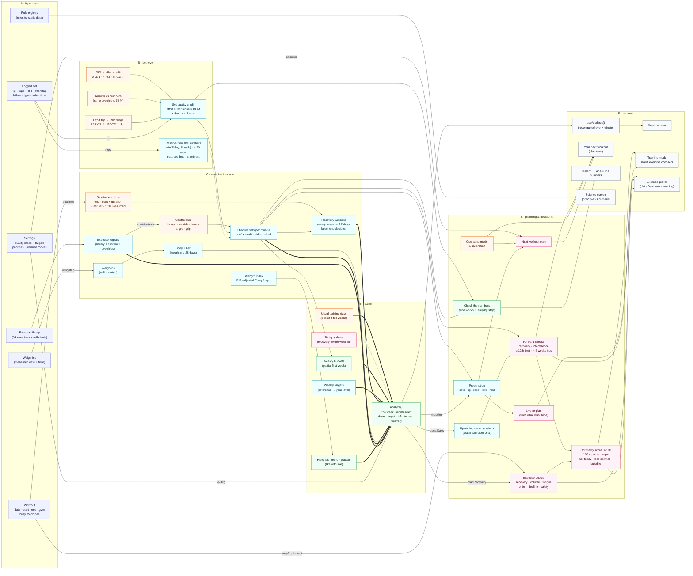

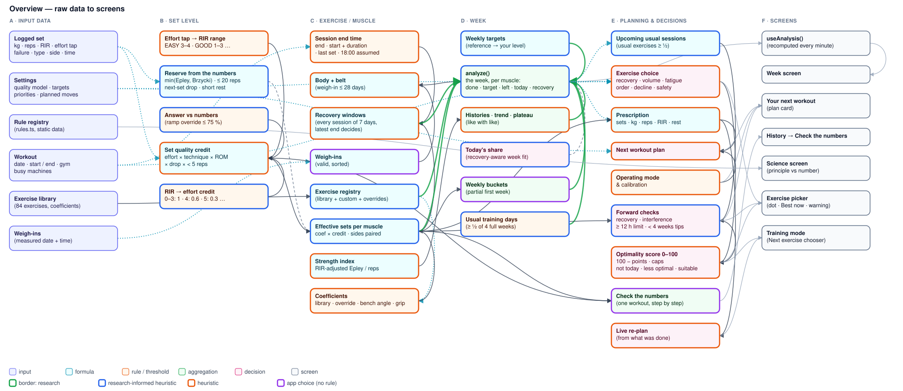
<!-- /map:overview -->

**Reading it:** a set is worth `coefficient × credit`; credits come from the logged RIR or the effort tap's range,
cross-checked with the numbers; `computeVolume` sums them per muscle; `analyze()` is the single hub every screen reads
(through `useAnalysis`, recomputed every minute) — the week, today's share, recovery, histories. Decisions (choice,
forward checks, plan, score) read the week from the `analysis` object; TODAY's done volume, however, is recomputed by
`prescribe`, `replanPending` and the forward checks each (audit C-9).

## 2. Set level — what one logged set is worth

<!-- map:set-level -->
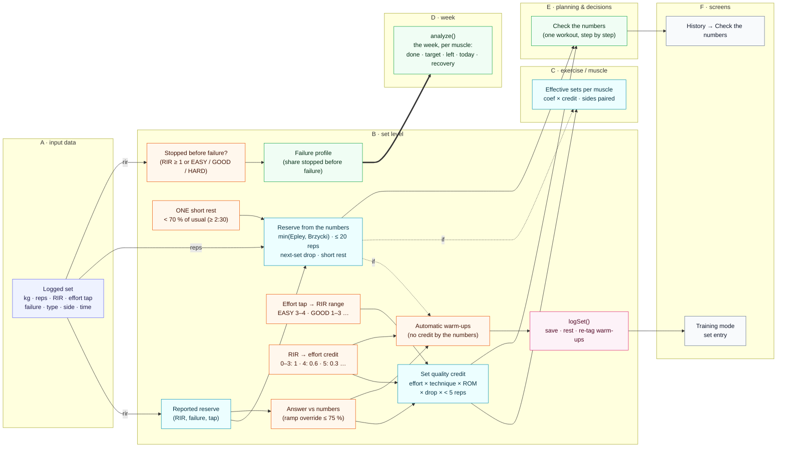

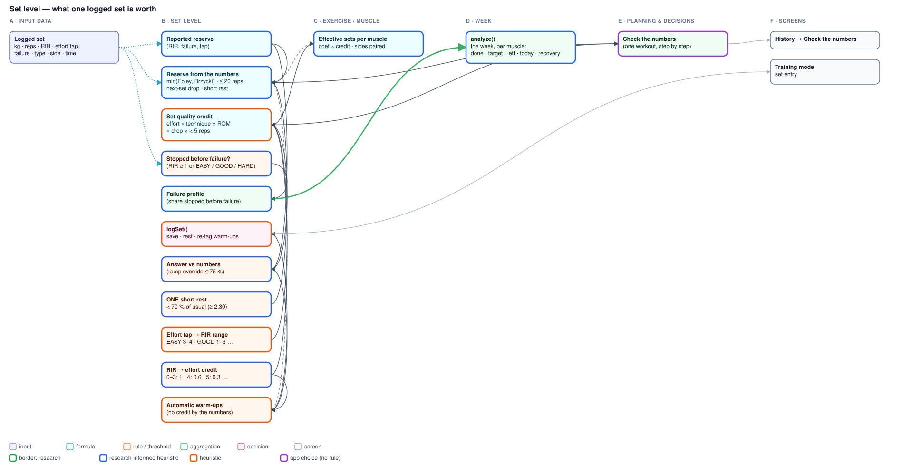
<!-- /map:set-level -->

## 3. Volume, weekly targets and today's share

<!-- map:volume-week -->
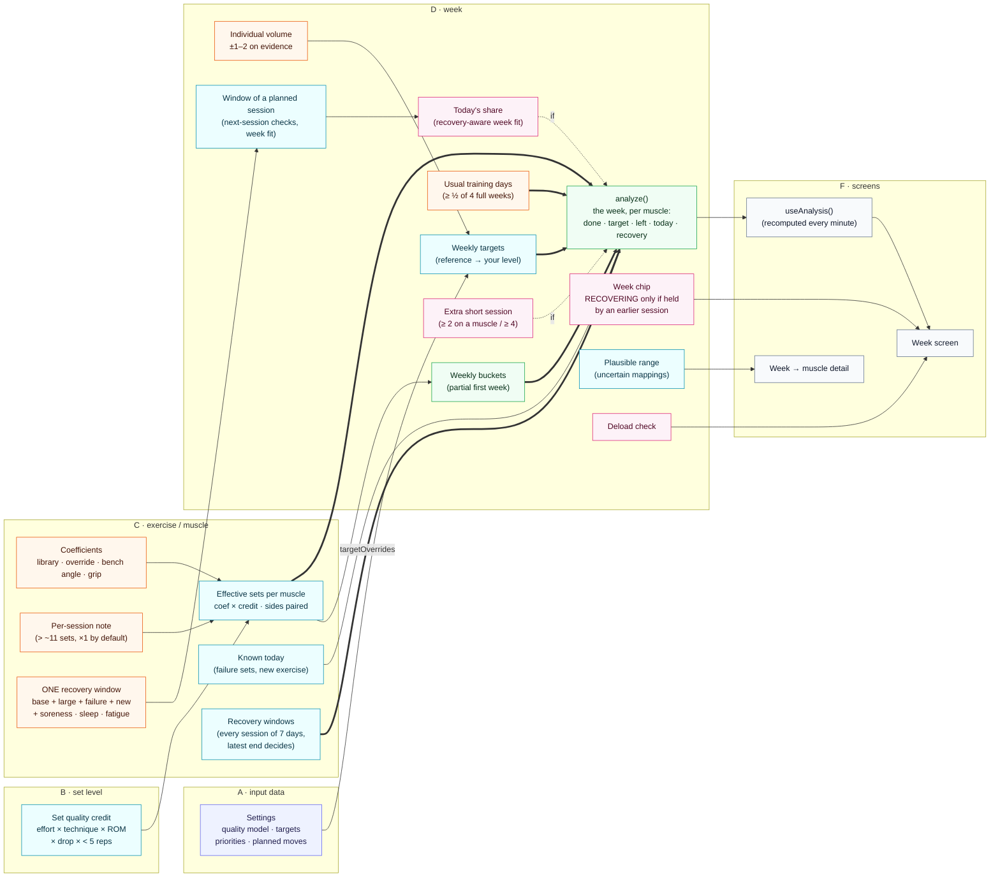

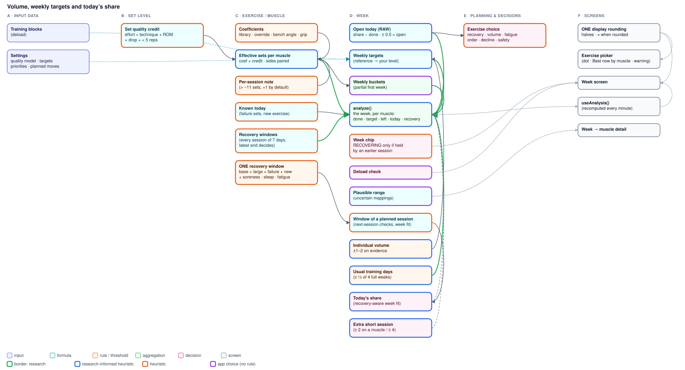
<!-- /map:volume-week -->

## 4. Strength index, trend and double progression

<!-- map:strength -->
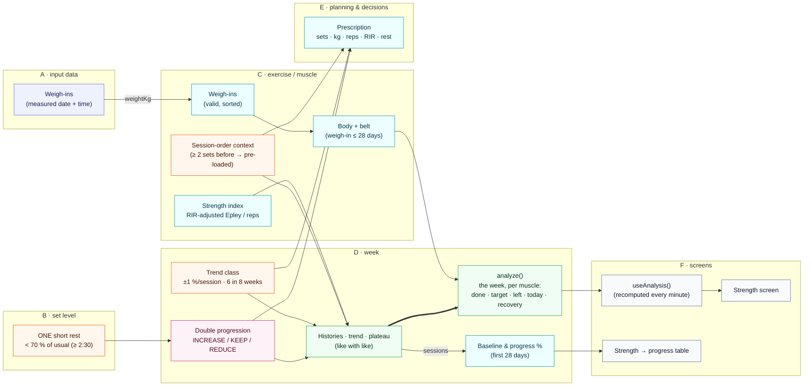

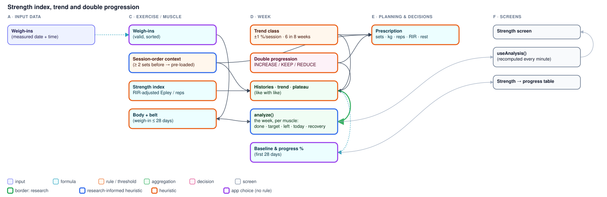
<!-- /map:strength -->

## 5. Planning and recommendation pipeline

<!-- map:planning -->
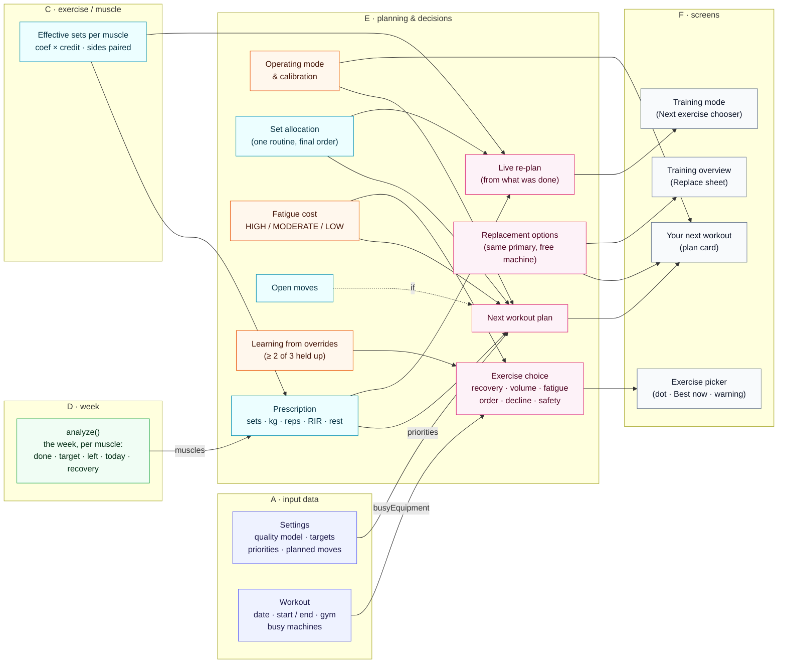

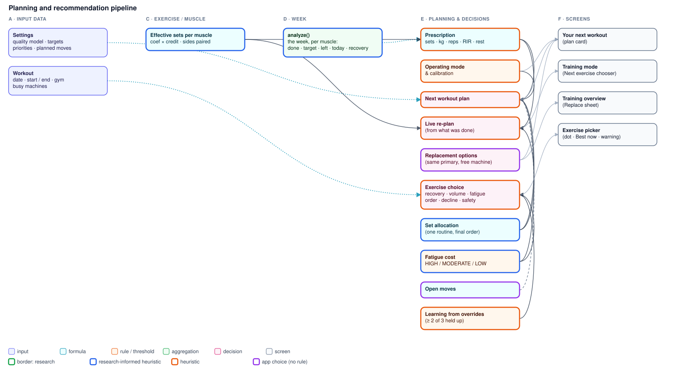
<!-- /map:planning -->

## 6. Recovery and next-session interference

<!-- map:recovery-interference -->
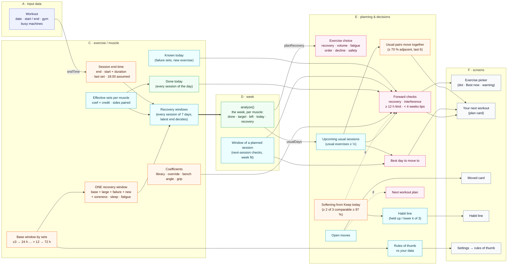

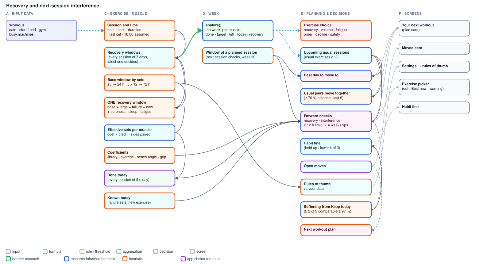
<!-- /map:recovery-interference -->

## 7. Training mode — set by set (restored 2026-11-24)

<!-- map:training -->
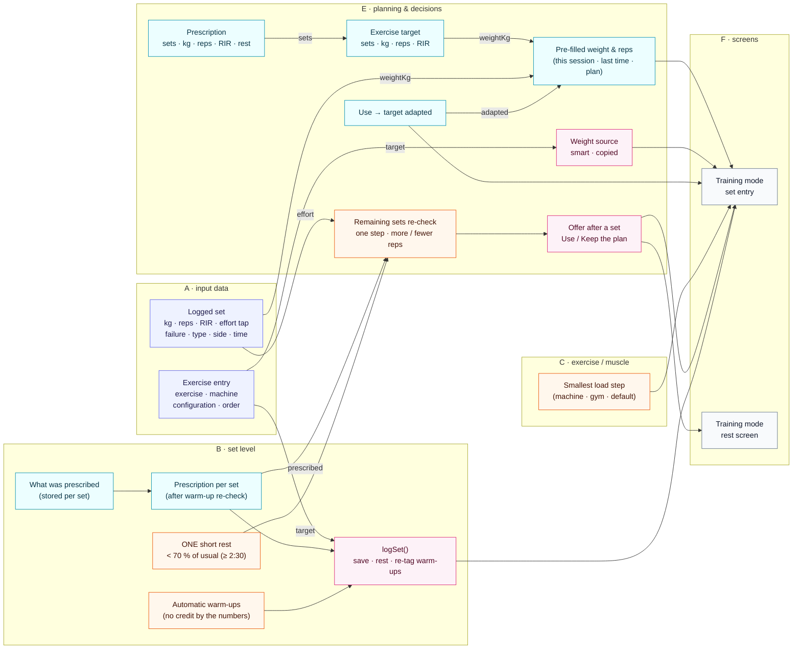

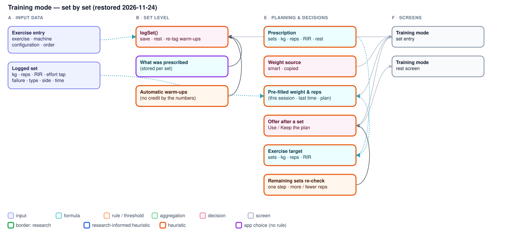
<!-- /map:training -->

## 7b. Exercise optimality score (Part 9)

<!-- map:optimality -->
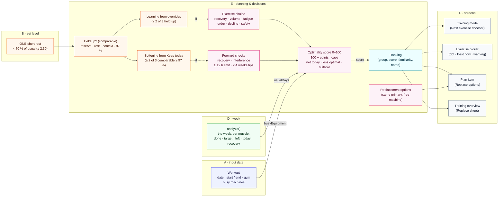

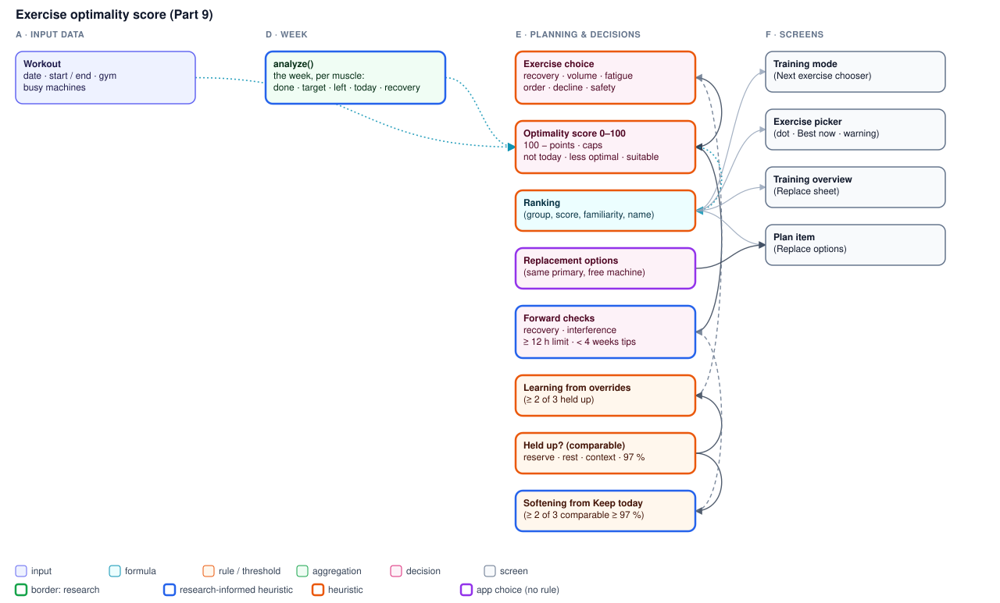
<!-- /map:optimality -->

## 8. Node traceability

Generated from the code graph ("Reads" = other-file domain declarations it references, helpers such as dates and text
omitted; "Used by" = declarations in other files that reference it; at most 8 each). Rules and basis from `rules.ts`.
"Tests" = test files that call the function by name; a decision covered only through its callers says so.

<!-- map:trace -->
| Node | Layer · kind | File · function | Reads (from) | Used by | Rules (basis) | Tests that call it directly |
|---|---|---|---|---|---|---|
| **rir_range** Effort tap → RIR range | B · rule | `domain/feedback` · `estimatedRirRange` | — | domain/quality#assessSet, ui/pages/Logger#SetFeedback | feel_estimated_rir (heuristic), unknown_effort (heuristic) | audit-gaps.test.ts |
| **reported** Reported reserve | B · formula | `domain/perception` · `reportedRir` | failure#failureImpliedRir, feedback#EFFORT_RIR_ESTIMATE | domain/workoutCheck#workoutCheck | failure_no_bonus (research_informed_heuristic) | part6-flow.test.ts |
| **objective** Reserve from the numbers | B · formula | `domain/perception` · `objectiveForSets` | rest#isShortRest | domain/volume#computeVolume, domain/volume#qualitySetTotal, domain/workoutCheck#workoutCheck | perception_check (research_informed_heuristic) | part6-flow.test.ts, part6-review.test.ts, part7-fixes.test.ts, part7-formulas.test.ts +1 |
| **cross** Answer vs numbers | B · rule | `domain/perception` · `crossCheck` | — | domain/quality#assessSet | perception_check (research_informed_heuristic) | part6-flow.test.ts, part6-review.test.ts |
| **credit_rir** RIR → effort credit | B · rule | `domain/perception` · `creditForRir` | — | domain/quality#assessSet | rir_credit_table (research_informed_heuristic) | part6-flow.test.ts |
| **assess** Set quality credit | B · formula | `domain/quality` · `assessSet` | failure#failureImpliedRir, failure#techniqueWithFailure, feedback#EFFORT_LABEL, feedback#FEEL_BY_ID, feedback#estimatedRirRange, feedback#formatRirRange, feedback#hasPain, feedback#painAreaLabel | domain/volume#computeVolume, domain/volume#qualitySetTotal, domain/workoutCheck#workoutCheck, ui/pages/History#SessionCard, ui/pages/Logger#SetRow | rir_credit_table (research_informed_heuristic), compromised_technique (heuristic), drop_and_low_reps (research_informed_heuristic), rom_partials (research_informed_heuristic), unknown_effort (heuristic) | analytics.test.ts, audit-fixes.test.ts, failure.test.ts, feedback.test.ts +5 |
| **warmups** Automatic warm-ups | B · rule | `domain/perception` · `reclassifyWarmups` | — | domain/liveFlow#editSet, domain/liveFlow#logSet | warmup_by_reserve (research_informed_heuristic), warmups_not_counted (heuristic) | part6-flow.test.ts, part6-review.test.ts |
| **failure** Failure profile | B · aggregation | `domain/failure` · `failureProfile` | registry#buildRegistry, sets#isCounted, sets#sideFactors | domain/analysis#analyze, domain/reports#weeklyReport | failure_share (research_informed_heuristic), failure_no_bonus (research_informed_heuristic) | failure.test.ts, part7-formulas.test.ts, part8-review.test.ts |
| **stopped** Stopped before failure? | B · rule | `domain/failure` · `stoppedBeforeFailureInferred` | — | — | failure_share (research_informed_heuristic) | audit-gaps.test.ts |
| **logset** logSet() | B · decision | `domain/liveFlow` · `logSet` | perception#reclassifyWarmups, sessionSummary#measuredRestSec | ui/pages/Train#ExerciseScreens | log_after_set (heuristic) | audit-gaps.test.ts, part6-flow.test.ts, part6-review.test.ts, second-analysis.test.ts +1 |
| **registry** Exercise registry | C · formula | `domain/registry` · `buildRegistry` | src/data/exercises#SEED_EXERCISES | domain/analysis#analyze, domain/failure#failureProfile | fractional_coefficients (research_informed_heuristic) | analytics.test.ts, audit-fixes.test.ts, audit-gaps.test.ts, baseline.test.ts +20 |
| **coef** Coefficients | C · rule | `domain/registry` · `resolveCoefficients` | — | domain/fatigue#significantMuscles, domain/planner#generateWorkout, domain/planner#replanPending, domain/preload#preloadFor, domain/prescription#planWarmups, domain/prescription#prescribe, domain/recovery#estimateRecovery, domain/recovery#todayExtraH | fractional_coefficients (research_informed_heuristic), bench_angle_groups (research_informed_heuristic), supinated_vertical_pull (heuristic) | analytics.test.ts, exercise-audit.test.ts, preferred.test.ts |
| **volume** Effective sets per muscle | C · formula | `domain/volume` · `computeVolume` | muscles#involvement, perception#objectiveForSets, perception#withoutAutoWarmups, quality#assessSet, quality#isCounted, quality#sideFactors, quality#taperBeyondCap, registry#resolveCoefficients | domain/analysis#analyze, domain/history#weeklyHistory, domain/mappingUncertainty#mappingSpread, domain/planner#replanPending, domain/prescription#prescribe, domain/recovery#estimateRecovery, domain/reports#baselineReport, domain/sequence#doneToday | fractional_coefficients (research_informed_heuristic), regional_emphasis_not_added (research_informed_heuristic) | analytics.test.ts, audit-fixes.test.ts, baseline.test.ts, exercise-audit.test.ts +14 |
| **taper** Per-session note | C · rule | `domain/quality` · `taperBeyondCap` | — | domain/volume#computeVolume | session_taper (heuristic) | review.test.ts |
| **perf** Strength index | C · formula | `domain/progression` · `sessionPerf` | failure#failureImpliedRir, feedback#benchmarkExclusion, feedback#techniqueOf | — | index_scale (heuristic), index_basis (heuristic) | analytics.test.ts, failure.test.ts, feedback.test.ts, preferred.test.ts +1 |
| **preload** Session-order context | C · rule | `domain/preload` · `preloadFor` | quality#sideFactors, registry#resolveCoefficients | domain/prescription#prescribe, domain/progression#buildProgression, domain/workoutCheck#workoutCheck | preload_context (research_informed_heuristic) | part6-perception.test.ts |
| **bodyidx** Body + belt | C · formula | `domain/bodyweight` · `bodyKgForIndex` | — | domain/analysis#analyze, domain/reports#progressionAsOf | index_scale (heuristic) | audit-gaps.test.ts |
| **basewin** Base window by sets | C · rule | `domain/recovery` · `baseWindowHours` | — | domain/ruleChecks#ruleChecks | recovery_windows (heuristic) | review.test.ts |
| **recovery** Recovery windows | C · formula | `domain/recovery` · `estimateRecovery` | dates#sessionEndVirtualMs, failure#isFailureSetForFatigue, quality#sideFactors, registry#resolveCoefficients, volume#computeVolume, volume#sessionMuscleEffective | domain/analysis#analyze | recovery_windows (heuristic) | review.test.ts, second-analysis.test.ts |
| **weekly** Weekly buckets | D · aggregation | `domain/history` · `weeklyHistory` | dates#weekOf, volume#computeVolume | domain/analysis#analyze | no rule — app choice | audit-gaps.test.ts |
| **volresp** Individual volume | D · rule | `domain/volumeResponse` · `volumeDecision` | history#median | domain/targets#computeTargets | volume_individual (research_informed_heuristic) | **none — covered only through callers** |
| **targets** Weekly targets | D · formula | `domain/targets` · `computeTargets` | history#cv, history#median, volumeResponse#volumeDecision | domain/analysis#analyze | weekly_target_reference (research_informed_heuristic), volume_individual (research_informed_heuristic) | **none — covered only through callers** |
| **usual** Usual training days | D · rule | `domain/weekPlan` · `usualTrainingDays` | — | domain/analysis#analyze | todays_share (research_informed_heuristic) | part7-weekplan.test.ts, part8-validation.test.ts |
| **fit** Today's share | D · decision | `domain/weekPlan` · `fitToday` | — | domain/analysis#analyze | todays_share (research_informed_heuristic) | part7-weekplan.test.ts |
| **extra** Extra short session | D · decision | `domain/weekPlan` · `suggestExtraSession` | — | domain/analysis#analyze | todays_share (research_informed_heuristic) | part7-weekplan.test.ts |
| **prog** Histories · trend · plateau | D · aggregation | `domain/progression` · `buildProgression` | increments#loadStep, preload#preloadFor | domain/analysis#analyze, domain/reports#progressionAsOf | plateau (heuristic), single_bad_session (heuristic), sustained_decline (heuristic), index_basis (heuristic) | analytics.test.ts, baseline.test.ts, bodyweight.test.ts, failure.test.ts +4 |
| **trend** Trend class | D · rule | `domain/progression` · `classifyTrend` | — | domain/prescription#prescribe | plateau (heuristic), single_bad_session (heuristic), sustained_decline (heuristic) | analytics.test.ts, feedback.test.ts, review-part4.test.ts, review.test.ts |
| **nextload** Double progression | D · decision | `domain/progression` · `suggestNextLoad` | feedback#exclusionLabel | domain/prescription#prescribe | double_progression (heuristic), benchmark_exclusion (heuristic), rest_attribution (research_informed_heuristic) | analytics.test.ts, review.test.ts |
| **baseline** Baseline & progress % | D · formula | `domain/baseline` · `strengthProgress` | progression#comparableSessions | ui/pages/Reports#FourWeekCheck, ui/pages/Strength#ProgressTable | no rule — app choice | audit-fixes.test.ts, baseline.test.ts, part6-perception.test.ts, review-part4.test.ts +2 |
| **analyze** analyze() | D · aggregation | `domain/analysis` · `analyze` | bodyweight#bodyKgForIndex, dates#daysLeftInWeek, dates#localNowParts, dates#weekOf, failure#failureProfile, history#mean, history#weeklyHistory, perception#withoutAutoWarmups | ui/hooks#analyzeWith, ui/hooks#useAnalysis | todays_share (research_informed_heuristic), weekly_target_reference (research_informed_heuristic) | analytics.test.ts, audit-fixes.test.ts, audit-gaps.test.ts, exercise-audit.test.ts +33 |
| **readiness** Operating mode | E · rule | `domain/readiness` · `readinessReport` | quality#isCounted, registry#MACHINE_KINDS | domain/planner#generateWorkout, ui/components/NextWorkout#NextWorkoutCard, ui/pages/Settings#PlannerCard | planner_modes (heuristic), planner_calibration (heuristic) | audit-gaps.test.ts, i18n-engine.test.ts, part5-planner.test.ts, part5-report.test.ts +1 |
| **prescribe** Prescription | E · formula | `domain/prescription` · `prescribe` | dates#localNowParts, feedback#benchmarkExclusion, increments#loadStep, preload#PRELOAD_DEFAULT_DROP, preload#expectedRepDrop, preload#preloadFactor, preload#preloadFor, progression#adviceFor | domain/planner#generateWorkout, domain/planner#replanPending, ui/pages/Logger#safePrescribe | presc_set_count (heuristic), presc_rep_ranges (research_informed_heuristic), presc_rir_targets (research_informed_heuristic), presc_rest (research_informed_heuristic), presc_confidence (heuristic) | i18n-engine.test.ts, part6-perception.test.ts, prescription.test.ts, six-month.test.ts +1 |
| **alloc** Set allocation | E · formula | `domain/planner` · `allocateSets` | — | — | planner_session_allocation (research_informed_heuristic) | part7-planner.test.ts |
| **planner** Next workout plan | E · decision | `domain/planner` · `generateWorkout` | exerciseChoice#availableEquipment, exerciseChoice#exerciseSessionCounts, exerciseChoice#safetyLine, fatigue#FATIGUE_RANK, fatigue#fatigueCostOf, fatigue#significantMuscles, prescription#prescribe, progression#progressionKey | ui/components/NextWorkout#NextWorkoutCard | planner_session_allocation (research_informed_heuristic), exercise_order (research_informed_heuristic), planner_returning (heuristic) | audit-fixes.test.ts, audit-gaps.test.ts, i18n-engine.test.ts, part5-planner.test.ts +8 |
| **replan** Live re-plan | E · decision | `domain/planner` · `replanPending` | dates#localNowParts, prescription#prescribe, registry#resolveCoefficients, volume#computeVolume, volume#sessionMuscleEffective | ui/pages/Train#TrainSession | planner_live_reassessment (heuristic) | part5-planner.test.ts, part5-review.test.ts, part7-planner.test.ts |
| **replace** Replacement options | E · decision | `domain/planner` · `replacementOptions` | exerciseChoice#availableEquipment, exerciseChoice#exerciseSessionCounts, exerciseChoice#priorWorkouts, fatigue#FATIGUE_LABEL, fatigue#fatigueCostOf, fatigue#significantMuscles | ui/components/NextWorkout#NextWorkoutCard, ui/pages/Train#Overview | no rule — app choice | part5-planner.test.ts, part5-review.test.ts |
| **fatigue** Fatigue cost | E · rule | `domain/fatigue` · `fatigueCostOf` | quality#isCounted | domain/exerciseChoice#assessChoice, domain/exerciseChoice#cheaperAlternatives, domain/exerciseChoice#doFirstAlternatives, domain/planner#generateWorkout, domain/planner#replacementOptions, domain/sequence#priorityOf | fatigue_cost (research_informed_heuristic) | audit-fixes.test.ts, part5-choice.test.ts |
| **choice** Exercise choice | E · decision | `domain/exerciseChoice` · `assessChoice` | analysis#RECOVERY_TOLERANCE_H, analysis#leftOfShare, fatigue#FATIGUE_LABEL, fatigue#fatigueCostOf, fatigue#isHeavyLower, fatigue#sessionLoad, fatigue#significantMuscles, progression#progressionKey | domain/optimality#optimality, ui/pages/Logger#ExercisePicker | choice_status (heuristic), exercise_order (research_informed_heuristic) | audit-fixes.test.ts, exercise-audit.test.ts, part5-choice.test.ts, part5-review.test.ts +1 |
| **choicelearn** Learning from overrides | E · rule | `domain/exerciseChoice` · `choiceOutcomes` | outcomes#heldUp, progression#progressionKey | ui/components/NextWorkout#ItemRow, ui/pages/Logger#ExercisePicker, ui/pages/Train#Overview, ui/pages/Train#TrainSession | choice_learning (heuristic) | audit-gaps.test.ts, part5-choice.test.ts |
| **upcoming** Upcoming usual sessions | E · formula | `domain/sequence` · `upcomingSessions` | registry#resolveCoefficients, weekPlan#weekdayOf | — | next_session_interference (research_informed_heuristic) | part8-sequence.test.ts |
| **forward** Forward checks | E · decision | `domain/sequence` · `forwardChecks` | registry#resolveCoefficients | domain/optimality#optimality, ui/components/NextWorkout#NextWorkoutCard, ui/pages/Logger#ExercisePicker | next_session_interference (research_informed_heuristic) | part8-habits.test.ts, part8-review.test.ts, part8-sequence.test.ts, part8-validation.test.ts +1 |
| **kept** Softening from Keep today | E · rule | `domain/sequence` · `keptOutcome` | outcomes#heldUp | — | next_session_interference (research_informed_heuristic) | part8-habits.test.ts, part8-validation.test.ts |
| **moveday** Best day to move to | E · decision | `domain/sequence` · `bestMoveDay` | analysis#RECOVERY_TOLERANCE_H, registry#resolveCoefficients, weekPlan#sessionWindowH | ui/components/NextWorkout#NextWorkoutCard, ui/pages/Logger#ExercisePicker | next_session_interference (research_informed_heuristic) | part8-review.test.ts, part8-sequence.test.ts |
| **partners** Usual pairs move together | E · rule | `domain/sequence` · `movePartners` | — | ui/components/NextWorkout#NextWorkoutCard | next_session_interference (research_informed_heuristic) | part8-habits.test.ts, part8-validation.test.ts |
| **moves** Open moves | E · formula | `domain/sequence` · `activeMoves` | — | domain/planner#generateWorkout, ui/pages/Dashboard#MovedCard | no rule — app choice | part8-sequence.test.ts |
| **habit** Habit line | E · formula | `domain/sequence` · `forwardHabit` | — | ui/pages/Dashboard#HabitLine | next_session_interference (research_informed_heuristic) | part8-habits.test.ts, part8-validation.test.ts |
| **optimality** Optimality score 0–100 | E · decision | `domain/optimality` · `optimality` | exerciseChoice#assessChoice, exerciseChoice#availableEquipment, exerciseChoice#exerciseSessionCounts, exerciseChoice#priorWorkouts, fatigue#significantMuscles, registry#MACHINE_KINDS, sequence#forwardChecks, sequence#usualSetCount | ui/components/NextWorkout#ItemRow, ui/pages/Logger#ExercisePicker, ui/pages/Train#Overview, ui/pages/Train#TrainSession | exercise_optimality (heuristic) | part9-optimality.test.ts |
| **rank** Ranking | E · formula | `domain/optimality` · `rankOptions` | — | ui/components/NextWorkout#ItemRow, ui/pages/Logger#ExercisePicker, ui/pages/Train#Overview, ui/pages/Train#TrainSession | exercise_optimality (heuristic) | part9-optimality.test.ts |
| **wcheck** Check the numbers | E · aggregation | `domain/workoutCheck` · `workoutCheck` | liveFlow#effortTapOf, perception#objectiveForSets, perception#reportedRir, perception#withoutAutoWarmups, preload#preloadFor, progression#progressionKey, quality#assessSet, quality#isCounted | ui/pages/WorkoutCheck#WorkoutCheckPage | no rule — app choice | workout-check.test.ts |
| **ui_analysis** useAnalysis() | F · ui | `ui/hooks` · `useAnalysis` | analysis#analyze | ui/components/EquipmentPicker#EquipmentPicker, ui/components/NextWorkout#ItemRow, ui/components/NextWorkout#NextWorkoutCard, ui/pages/Body#BodyPage, ui/pages/Dashboard#AdviceRow, ui/pages/Dashboard#DashboardPage, ui/pages/Dashboard#ExtraSessionCard, ui/pages/Dashboard#HabitLine | — | e2e |
| **ui_week** Week screen | F · ui | `ui/pages/Dashboard` · `DashboardPage` | dates#formatDate, effort#effortCoverage, reports#assessDeload, reports#buildSnapshot, reports#pendingSnapshot | — | — | e2e |
| **ui_moved** Moved card | F · ui | `ui/pages/Dashboard` · `MovedCard` | dates#formatDate, sequence#activeMoves, sequence#moveNeedsSetup | — | — | e2e |
| **ui_habitline** Habit line | F · ui | `ui/pages/Dashboard` · `HabitLine` | sequence#forwardHabit | — | — | e2e |
| **ui_plan** Your next workout | F · ui | `ui/components/NextWorkout` · `NextWorkoutCard` | dates#formatDate, dates#localNowParts, planner#generateWorkout, planner#replacementOptions, planner#workoutFromPlan, readiness#MODE_LABEL, readiness#readinessReport, sequence#addMoves | ui/pages/Dashboard#DashboardPage | — | e2e |
| **ui_itemrow** Plan item | F · ui | `ui/components/NextWorkout` · `ItemRow` | exerciseChoice#choiceOutcomes, optimality#optimality, optimality#rankOptions, progression#stepLoad, progression#variationParts | — | — | e2e |
| **ui_train** Training mode | F · ui | `ui/pages/Train` · `TrainSession` | dates#localNowParts, exerciseChoice#choiceOutcomes, liveFlow#exerciseProgress, liveFlow#restState, optimality#optimality, optimality#rankOptions, planner#applyPendingUpdate, planner#replanPending | — | — | e2e |
| **ui_sets** Training mode | F · ui | `ui/pages/Train` · `ExerciseScreens` | increments#loadStep, liveFlow#ANY_DOUBLE_TAP_MS, liveFlow#adjustRest, liveFlow#applyOffer, liveFlow#clearOtherRestEnds, liveFlow#editSet, liveFlow#effortTapOf, liveFlow#effortTapPatch | — | — | e2e |
| **ui_overview** Training overview | F · ui | `ui/pages/Train` · `Overview` | dates#formatDate, exerciseChoice#choiceOutcomes, liveFlow#REST_DEFAULT_SEC, liveFlow#exerciseProgress, liveFlow#mmss, optimality#optimality, optimality#rankOptions, planner#replacementOptions | — | — | e2e |
| **ui_picker** Exercise picker | F · ui | `ui/pages/Logger` · `ExercisePicker` | dates#formatDate, exerciseChoice#assessChoice, exerciseChoice#choiceOutcomes, exerciseChoice#exerciseSessionCounts, exerciseChoice#needsPrompt, exerciseChoice#priorWorkouts, fatigue#significantMuscles, optimality#optimality | ui/pages/Train#TrainSession | — | e2e |
| **ui_check** History → Check the numbers | F · ui | `ui/pages/WorkoutCheck` · `WorkoutCheckPage` | dates#formatDate, workoutCheck#workoutCheck | — | — | e2e |
| **ui_strength** Strength screen | F · ui | `ui/pages/Strength` · `StrengthPage` | — | — | — | e2e |
| **ui_science** Science screen | F · ui | `ui/pages/Science` · `RuleList` | rules#RULES | — | — | e2e |
| **window** ONE recovery window | C · rule | `domain/recovery` · `windowHours` | — | domain/weekPlan#sessionWindowH | recovery_windows (heuristic) | audit-fixes.test.ts, failure.test.ts, part7-formulas.test.ts, recovery-time.test.ts +3 |
| **todayextra** Known today | C · formula | `domain/recovery` · `todayExtraH` | failure#isFailureSetForFatigue, quality#sideFactors, registry#resolveCoefficients | domain/analysis#analyze, domain/sequence#checksFrom | recovery_windows (heuristic) | **none — covered only through callers** |
| **sesswin** Window of a planned session | D · formula | `domain/weekPlan` · `sessionWindowH` | recovery#windowHours | domain/sequence#bestMoveDay, domain/sequence#checksFrom, domain/sequence#issuesIfDoneOn | recovery_windows (heuristic) | second-analysis.test.ts |
| **shortrest** ONE short rest | B · rule | `domain/rest` · `isShortRest` | — | domain/outcomes#heldUp, domain/perception#objectiveForSets, domain/prescription#adaptRemaining, domain/prescription#prescribe, domain/progression#restInsight | rest_attribution (research_informed_heuristic) | second-analysis.test.ts |
| **donetoday** Done today | C · aggregation | `domain/sequence` · `doneToday` | volume#computeVolume | — | no rule — app choice | audit-fixes.test.ts, review.test.ts |
| **weekchip** Week chip | D · decision | `domain/analysis` · `weekChip` | — | ui/pages/Dashboard#statusChip | recovery_windows (heuristic) | second-analysis.test.ts |
| **applyoffer** Use → target adapted | E · formula | `domain/liveFlow` · `applyOffer` | — | ui/pages/Train#ExerciseScreens | presc_set_by_set (heuristic) | audit-gaps.test.ts |
| **withpresc** Prescription per set | B · formula | `domain/liveFlow` · `withPrescribed` | — | — | no rule — app choice | **none — covered only through callers** |
| **loadstep** Smallest load step | C · rule | `domain/increments` · `loadStep` | — | domain/prescription#prescribe, domain/progression#buildProgression, ui/pages/Logger#ExerciseCard, ui/pages/Strength#SeriesDetail, ui/pages/Train#ExerciseScreens | no rule — app choice | equipment-memory.test.ts, failure.test.ts, part6-review.test.ts |
| **targetp** Exercise target | E · formula | `domain/planner` · `targetFromPrescription` | prescription#PRESCRIPTION_ENGINE | ui/pages/Train#TrainSession | presc_set_count (heuristic), presc_rir_targets (research_informed_heuristic) | audit-gaps.test.ts |
| **prefill** Pre-filled weight & reps | E · formula | `domain/liveFlow` · `prefillNext` | — | ui/pages/Train#ExerciseScreens | log_after_set (heuristic) | audit-gaps.test.ts, part6-flow.test.ts, part6-review.test.ts |
| **wsource** Weight source | E · decision | `domain/liveFlow` · `weightSource` | — | ui/pages/Train#ExerciseScreens | log_after_set (heuristic) | audit-gaps.test.ts, second-analysis.test.ts |
| **adapt** Remaining sets re-check | E · rule | `domain/prescription` · `adaptRemaining` | feedback#benchmarkExclusion, feedback#hasPain, feedback#techniqueOf, progression#stepLoad, quality#countedSetCount, rest#isShortRest, rest#usualRestSec | domain/liveFlow#nextSetsOffer | presc_set_by_set (heuristic) | prescription.test.ts |
| **offer** Offer after a set | E · decision | `domain/liveFlow` · `nextSetsOffer` | prescription#adaptRemaining | ui/pages/Train#ExerciseScreens | presc_set_by_set (heuristic) | audit-gaps.test.ts, second-analysis.test.ts |
| **prescrec** What was prescribed | B · formula | `domain/liveFlow` · `prescribedFor` | — | — | no rule — app choice | **none — covered only through callers** |
| **heldup** Held up? (comparable) | E · rule | `domain/outcomes` · `heldUp` | rest#isShortRest | domain/exerciseChoice#choiceOutcomes, domain/sequence#keptOutcome | choice_learning (heuristic) | **none — covered only through callers** |
| **ui_rest** Training mode | F · ui | `ui/pages/Train` · `RestScreen` | liveFlow#REST_STEP_SEC, liveFlow#effortTapOf, liveFlow#mmss, liveFlow#restState, liveFlow#restTargetFor | — | — | e2e |
| **sessionend** Session end time | C · rule | `domain/dates` · `sessionEndVirtualMs` | — | domain/recovery#estimateRecovery, domain/ruleChecks#ruleChecks | recovery_windows (heuristic) | recovery-time.test.ts |
| **weighins** Weigh-ins | C · formula | `domain/bodyweight` · `weighIns` | — | — | no rule — app choice | audit-gaps.test.ts |
| **deload** Deload check | D · decision | `domain/reports` · `assessDeload` | history#mean | ui/pages/Dashboard#DashboardPage, ui/pages/Periodization#PeriodizationPage | no rule — app choice | audit-fixes.test.ts, reports.test.ts |
| **mapspread** Plausible range | D · formula | `domain/mappingUncertainty` · `mappingSpread` | volume#computeVolume | ui/pages/Dashboard#MuscleDetail | no rule — app choice | ux-limitations.test.ts |
| **rulechecks** Rules of thumb | E · formula | `domain/ruleChecks` · `ruleChecks` | dates#sessionEndVirtualMs, dates#workoutVirtualMs, recovery#baseWindowHours, registry#resolveCoefficients, volume#sessionMuscleEffective | ui/pages/Settings#RuleChecksCard | recovery_windows (heuristic), exercise_order (research_informed_heuristic) | ux-limitations.test.ts |
| **ui_muscledetail** Week → muscle detail | F · ui | `ui/pages/Dashboard` · `MuscleDetail` | mappingUncertainty#mappingSpread | — | — | e2e |
| **ui_rulecheck** Settings → rules of thumb | F · ui | `ui/pages/Settings` · `RuleChecksCard` | ruleChecks#ruleChecks | — | — | e2e |
| **ui_progress** Strength → progress table | F · ui | `ui/pages/Strength` · `ProgressTable` | baseline#strengthProgress | — | — | e2e |
<!-- /map:trace -->

### Decision paths without a direct test (covered only through their callers)

<!-- map:untested -->
- `domain/volumeResponse#volumeDecision` (volresp)
- `domain/targets#computeTargets` (targets)
- `domain/recovery#todayExtraH` (todayextra)
- `domain/liveFlow#withPrescribed` (withpresc)
- `domain/liveFlow#prescribedFor` (prescrec)
- `domain/outcomes#heldUp` (heldup)
<!-- /map:untested -->

## 9. Worked examples (real values; the test that recomputes each is named)

**Example 1 — logging sets → weekly volume.** Monday: pec deck 4 × 40 kg × 12 at RIR 2, then incline dumbbell press
1 × 26 kg × 10 answered EASY (no RIR).
1. Pec deck: RIR 2 → credit 1.0 (`creditForRir`, rule `rir_credit_table`); coefficients chest 1, front delts 0.25
   (`resolveCoefficients`) → per set chest 1.0, front delts 0.25 → ×4 = chest 4.0, front delts 1.0.
2. Incline press: EASY → RIR range 3–4 (`estimatedRirRange`) → credit = average of the table over the range,
   (1.0 + 0.6) ÷ 2 = 0.8 (rule `feel_estimated_rir`); coefficients chest 1, front delts 0.5, triceps 0.5 → chest 0.8,
   front delts 0.4, triceps 0.4.
3. `computeVolume` → week so far: chest 4.8, front delts 1.4, triceps 0.4 effective sets → `analyze()` subtracts them
   from the weekly target and today's share → the Week screen's LEFT column. *(formula-map.test.ts, example 1)*

**Example 2 — choosing the next exercise.** Same Monday (usual week Mon pec deck + curls, Tue pull-ups + rows,
Thu legs + pec deck, 4 full weeks), 17:30, 4 pec-deck sets done.
1. Pull-ups, 2 sets: lats week open, no window open, lats window 24 h ends at Tuesday's session (inside the 6 h
   tolerance) → no forward finding; 4 sessions logged, bodyweight → **score 100, suitable**. *(formula-map.test.ts)*
2. Machine curls, 4 sets: biceps 4 effective → base window 36 h; Tuesday 17:00 is 24 h later → 12 h left ≥ 12 → a LIMIT
   on next-session performance (Tuesday's pull-ups use biceps 0.5, a high-priority compound) → **NOT TODAY**, no number,
   reason "May reduce Tuesday's pull-up — biceps still recovering." *(formula-map.test.ts: finding, hours, reason)*
3. Owner's case (Part 9 test): triceps week met → incline press loses 80 × 0.5 ÷ (1 + 0.5 + 0.5) = 20 points
   (secondary work on a met muscle), pec deck nothing → pec deck ranks first. *(formula-map.test.ts, example 2.3)*

**Example 3 — moving an exercise to another day.** The curls of example 2:
1. Recovery → interference: the limit above (`forwardChecks`).
2. Best day: `bestMoveDay` → Tuesday 2026-11-17, clean. *(formula-map.test.ts)*
3. Pairs: pec deck and curls are adjacent, but not related (no shared muscle ≥ 0.5, not both arm muscles) → the curls
   move alone (`movePartners` returns nothing). *(formula-map.test.ts)*
4. The move is stored (`Settings.plannedMoves`, `addMoves`); the Week screen shows it (`activeMoves` → Moved card).
5. On Tuesday the planner picks it up (`activeMoves` in `generateWorkout`) with its own set count (4) and orders it by
   the planner's own sort (priority muscle first, then fatigue HIGH → LOW): this week's Tuesday plan is pull-ups, then
   the curls (rows are not planned — the back's share is covered). This is the one order rule (audit C-2).
   *(formula-map.test.ts)*
6. During Tuesday's session `replanPending` re-prescribes it from what was done, and the chooser scores it in Tuesday's
   context (scored, not NOT TODAY). *(part9-optimality.test.ts R4)*

## 10. First analysis (2026-11-24) — all confirmed items resolved

Confirmed = checked in the code (file:line) and, where a number is involved, run. Risks = plausible, not proven; to
investigate. Nothing was changed: each item needs the owner's decision.

### Confirmed problems

| # | Kind | Finding | Where | Suggested action |
|---|---|---|---|---|
| C-1 | unused formula · stale doc | `adaptRemaining` (set-by-set re-check of the remaining sets of the CURRENT exercise) is never called by the app; CLAUDE.md §H says it runs after each set. Only exercises not yet started are re-prescribed (`replanPending`). | `src/domain/prescription.ts:637`; CLAUDE.md §H | wire it into the training mode, or correct CLAUDE.md |
| C-2 | duplicate logic · unused | `placeInSession` (where a moved exercise goes inside the new day) is tested but never called; the planner orders moved items with its own sort. Two order rules exist for the same question (CLAUDE.md §N's text matches the planner; its parenthetical describes the unused function). | `src/domain/sequence.ts:394`; `src/domain/planner.ts:450` | use one rule (call `placeInSession` from the planner or delete it) |
| C-3 | inconsistent thresholds | Two "learning from overrides" rules judge "held up" differently: Part 5 `choiceOutcomes` compares with the single previous session (`* 0.97` hard-coded, no RIR / rest / context check, the current session need not be representative, reps-based indices compared raw instead of on the Epley scale); Part 8 `keptOutcome` uses the median of ≤ 3 comparable sessions with those checks (`KEPT_NOT_LOWER`). Rule `choice_learning` says "not lower" while the code allows −3 %. The Part 8 validation fix was not applied to Part 5. | `src/domain/exerciseChoice.ts:245`; `src/domain/sequence.ts:241` | share one comparable-outcome routine |
| C-4 | logic outside the rule registry | Numbers that decide but are not in `rules.ts`: usual pairs (≥ 70 % adjacent, ≥ 3 sessions, last 6), planner muscle weights (priority ×1.3, maintain ×0.6), "recovery uncertain" within 18 h of an assumed session time. | `sequence.ts:303–306`; `planner.ts:298`; `exerciseChoice.ts` (`hoursLeft <= 18`) | add them to the rules they belong to (`next_session_interference`, `planner_session_allocation`, `choice_status`) |
| C-5 | duplicate definitions | `MACHINE_KINDS` is defined 6 times (same contents today); `median` at least 9 times with three behaviours on an empty list: 0 (`history.ts:35`), null (`prescription.ts:150`, `progression.ts:414`, `ruleChecks.ts:44`, `planner.ts:93`), NaN (`baseline.ts:30`, `preload.ts:117`, `progression.ts:294`, `sequence.ts:56`); whether every caller guards an empty list was not checked. | `exerciseChoice.ts:109`, `optimality.ts:88`, `planner.ts:60`, `readiness.ts:50`, `sequence.ts:152`, `ui/pages/Logger.tsx:38` | one shared helper each |
| C-6 | module cycles | `quality → perception → failure → quality` (one cycle of three modules) and `increments ↔ progression` (works today through hoisting; fragile). | code graph | move the shared piece into a leaf module |
| C-7 | unused exports | `planAdherence` (tested, no screen), `normalizeWeight` (tested only); `todayIn`, `inRange`, `isCleanMuscularFailure`, `isWrongWeight`, `round1` (quality.ts), `daysBetween` (neither used nor tested). | code graph (no consumer) | remove or use |
| C-8 | unused writer · stale doc | `toSetPrescription` is never called by the app, so a set's `prescribed` field is written only by the importer; CLAUDE.md §H says it is "written by the app". The `.prescribed` branches in `untouchedPlanned`, `planAdherence` and `adaptRemaining` never see app-created data. | `prescription.ts` (`toSetPrescription`), `importer.ts:517`, CLAUDE.md §H | wire it when a set is logged, or correct CLAUDE.md |
| C-9 | duplicate calculation | Today's done volume is recomputed separately by `prescribe`, `replanPending` and the forward checks (`doneToday`), next to `analyze()`'s own `doneToday`. Same formula today; a future change in one place would split them. | `prescription.ts:415`, `planner.ts` (`replanPending`), `sequence.ts` (`doneToday`) | pass one "done today" value |

### Resolution (owner 2026-11-24: "fix the gaps, but double check if the code is wrong or the map")

Each item was checked against git history and the docs first; tests in `tests/audit-gaps.test.ts` were written before
the fixes and failed.

| # | Who was wrong | What was done |
|---|---|---|
| C-1 | **the code** — the Part 6 training-mode rewrite (commit 3344046) dropped the set-by-set check that CLAUDE.md §H describes | restored: after each set `nextSetsOffer` (on `adaptRemaining`) offers a change of the remaining sets on the rest screen — Use / Keep the plan, never applied silently, Undo; the target is marked `adapted` |
| C-2 | **the code** — two order rules; the planner's is the one the app runs and the owner's tests describe | `placeInSession` removed; the owner's Part 8 order tests now drive the planner itself (curls after pull-ups; first only for a priority muscle) |
| C-3 | **the code** — Part 5 learning skipped the comparability checks Part 8 got | one shared check (`outcomes.ts` `heldUp`) for both; rule `choice_learning` now states 97 % and the skips |
| C-4 | **the registry** (doc) — the code is as intended | the numbers are now in `next_session_interference`, `planner_session_allocation`, `choice_status` |
| C-5 | **the code** (duplication) | one `MACHINE_KINDS` (registry.ts). `median`: kept as is — the copies differ on purpose on an empty list (0 / null / NaN) and unifying would change callers; not checked caller by caller |
| C-6 | **the code** | cycles removed: `isCounted` / `sideFactors` moved to the leaf module `sets.ts`, `defaultIncrement` to `increments.ts` (both still re-exported); the code graph has no module cycle now |
| C-7 | **the code** | removed `todayIn`, `inRange`, `isCleanMuscularFailure`, `isWrongWeight`, `round1` (quality), `daysBetween`; kept `planAdherence`, `normalizeWeight` (tested; may get a screen) |
| C-8 | **the code** — same commit dropped writing `prescribed` | restored: every logged set stores what was prescribed for it (from the target, with its RIR target); an older target without RIR writes nothing rather than an invented value |
| C-9 | neither yet — same formula in three places | kept; noted as a risk for the next formula change |

Also new (owner 2026-11-24): the training mode shows where the pre-filled weight came from — a brain "Smart weight" (the
analysis set it: changed, confirmed or adjusted after a set; with "+2.5 kg vs last time" / "same as last time") or
"Copied from last time — not analysed" (`weightSource`).

### Risks to investigate

| # | Kind | Risk | Where |
|---|---|---|---|
| R-1 | contradictory result | An open primary window with a fully assumed session time and ≤ 18 h left is "recovery uncertain" (−10), so the Part 9 score can show 90 "very good fit" while a window may be open (review 2026-11-24). | `exerciseChoice.ts` (RECOVERY_UNCERTAIN), `optimality.ts` |
| R-2 | defaults forced by missing inputs | Unknown rest counts as normal (next-set rule); unknown effort = 0.75; unknown end time = start + duration or 18:00; unknown set count for a move = 3 (`usualSetCount`). Each is documented, but a sparse history leans on them. | `perception.ts`, `quality.ts`, `dates.ts`, `sequence.ts:139` |
| R-3 | misinterpreted values | The individual target ("your level") can drift down when many sets are untapped (0.75) or carried over (Part 7 note). | `volumeResponse.ts`, `targets.ts` |
| R-4 | duplicate calculation / cost | The picker badge runs `assessChoice` for up to 40 rows per render; Part 9 scores call `forwardChecks` per row (each recomputes the upcoming sessions). Fast on 26 weeks (8 options ≈ 7 ms), unmeasured on years of data. | `Logger.tsx` (ExercisePicker), `optimality.ts` |
| R-5 | UI using other values | A partly done exercise in the Next exercise chooser counts its own sets as "this session" synergist load, so continuing it can cost itself 5–15 points. | `exerciseChoice.ts` (`this_session`) |
| R-6 | untested decision paths | No test drives `planAdherence` from a screen (it has none); `ruleChecks` verdicts are tested only on synthetic histories; the forward checks are not exercised in the six-month simulation. | — |

### Nodes without downstream consumers in the app

After the fixes: `planAdherence` and `toSetPrescription` (tested, no screen; the training mode writes the per-set record
with `prescribedFor`). Every node of the map reaches a screen in the code; not every such path is drawn in a view.

## 11. Second analysis (2026-11-24, after the fixes)

A fresh, independent pass over the regenerated map and the code (it did not trust the first pass). Every item was
checked against the code; tests were written first (`tests/second-analysis.test.ts`) and failed before the fixes.

### First-pass fixes re-checked

C-1, C-2, C-6, C-7, C-8 hold. C-3 and C-5 held only partly (fixed below). C-4 held for the numbers it named; more were
missing (B-5). C-9 had become a real difference (B-7).

### Findings and what was done

| # | Finding | Code or doc? | Resolution |
|---|---|---|---|
| B-1 | The Week chip showed RECOVERING from today's own sets and inside the 6 h tolerance while the plan and the chooser said sets are left today | code | the chip follows `todayBlocked` only (`analysis.weekChip`) |
| B-2 | The next-session checks and the week fit used a shorter window than the recovery screen (no + 12 h for failure / new exercise / sleep / soreness): "fine for Tuesday" on Monday, "blocked" on Tuesday | formula choice → **owner: one window everywhere** | `recovery.windowHours` is the one formula; the forward checks and the fit add what is known today (`todayExtraH`, `conditionsExtraH`); later days use the base |
| B-3 | The after-set "add load" offer was unreachable with taps (EASY ≠ "too easy") | formula choice → **owner: offer it** | EASY with reps at the top, clean technique → one step up for today's remaining sets (an offer); between sessions unchanged |
| B-4 | "Usual rest" had 5 definitions (60 s floor, today's median, history median, session averages, ± 30 %) | formula choice → **owner: one definition, usual never below 2:30** | `rest.ts`: short = < 70 % of the usual (today's median of ≥ 3, else history), usual ≥ 150 s → under 1:45; used by perception, the offer, the rest insight, the prescription's drop estimate and the outcome check |
| B-5 | Deciding numbers missing from `rules.ts` (individual volume, planner sizes, choice thresholds) | doc | added to `volume_individual`, `planner_session_allocation`, `choice_status`; `recovery_windows` and `rest_attribution` restated |
| B-7 | The forward checks saw only the live workout — a second session the same day was invisible | code | `doneToday` counts every session of the day |
| B-8 | "Copied from last time" also for this session's previous set (even with no last time) | code | its own state: "Same as your previous set" |
| B-9 / C-5 | The machine-kind list was still written inline 5 times | code | all use `MACHINE_KINDS` |
| B-12 | Removing / re-tagging a set left the other sets' prescriptions on the old set numbers | code | `editSet` re-numbers them (the prescribed load is kept) |
| B-13 | Stale CLAUDE.md (pre-fill order, order of a moved exercise, the offer and the weight mark missing) and FORMULA_AUDIT sections on removed functions | doc | CLAUDE.md §D, §G, §L, §N updated; FORMULA_AUDIT note |
| step | The offer used the session's ruler step (could be + 5 kg) | code | the equipment's smallest step (`loadStep`), as everywhere else |
| map | Week chip, the one window, the Use loop, the stored prescription feeding the re-check, the shared short-rest rule and today's volume were not drawn; the field check counted words inside strings | map | drawn (94 nodes, 195 edges); string literals are ignored by the check |

### Still open (risks, not fixed)

- **Two learning baselines** — Part 5 compares an overridden session with the single previous one, Part 8 with the
  median of ≤ 3 sessions not themselves after a kept conflict (the comparability check itself is shared). Kept: the
  owner's Part 5 test needs every override compared; unify only with the owner's OK.
- **"Left today" has two roundings** (screens round to halves and hide < 0.5; the planner uses the raw share minus done);
  the planner's "under half a set → none" hides most of the difference.
- **One-set plan items** can survive the final allocation (`allocateSets` allows 1, the selection asks for ≥ 2) — traced,
  not run.
- **The data-edge check is text-level** (a field name read with `.field` and a common caller within 3 references): each
  data edge's meaning was verified by hand; the check alone cannot prove a flow.
- The first analysis' R-1, R-3, R-4, R-5 still stand.

